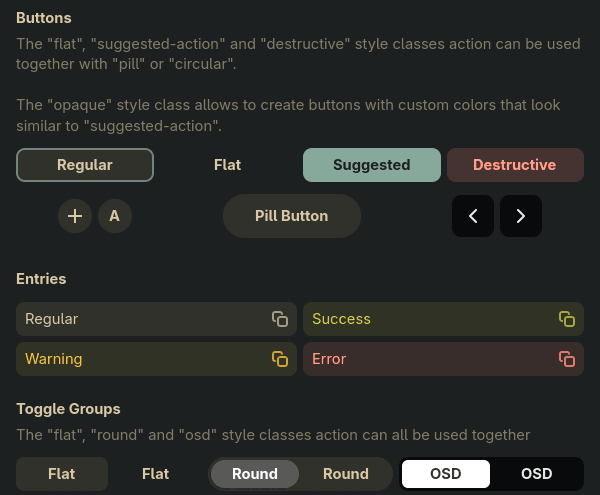
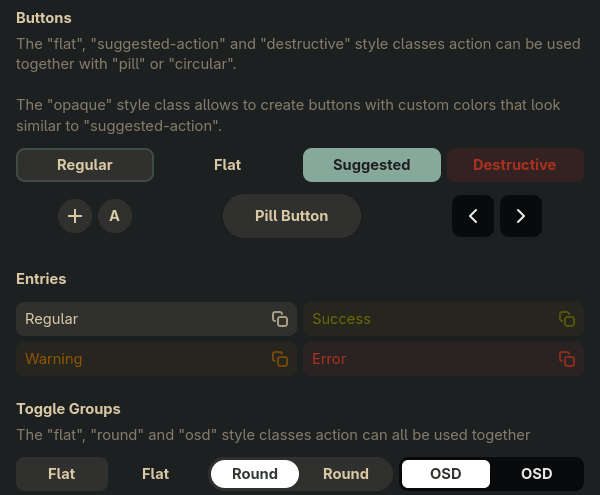

# Colour-scheme hooks

How to keep the desktop's dark/light colour scheme in step with the variant amontillado
applies, with a reload command and its `{variant}` placeholder. amontillado never sets the
scheme itself; this page is about the one line you add to your config if you want it to follow.

## Why a GTK theme needs it

The built-in `libadwaita` template ([design.md](design.md), "Template sources") defines libadwaita's
named colours from the palette. libadwaita ≥ 1.6 does not take the standalone text colours
(`accent_color`, `success_color`, `warning_color`, `error_color`, `destructive_color`) from that
file: it derives them from the matching `*_bg_color` by its own colour scheme, at most 0.5 OKLab
lightness for light and at least 0.85 for dark. A dark palette under a light scheme therefore
gets dark accent, success, warning and error text on a dark window: 2.5 to 2.8:1 with gruvbox
dark hard, measured in the amo-aqp.21 live test (2026-11-05), against the 4.5:1 the palette's
contrast check guarantees. Other things follow the scheme, not the palette, too: GtkSourceView's
style scheme in an editor (gnome-text-editor picks its dark or light style from it) and the
symbolic and illustrated assets apps ship per scheme.

The same gruvbox dark hard file in adwaita-1-demo's style classes, first under a dark scheme,
then under the default (light) one. Backgrounds and the suggested button follow the file in
both. In the second, the destructive label, the success, warning and error entry text and the
round toggle's label take libadwaita's light-scheme colours and sink into the window:





To see the failure live, run the live test's mismatch scenario: a dark palette with libadwaita left
on its default (light) scheme.

```sh
tools/libadwaita-live-test.sh mismatch
```

## Why amontillado leaves it to you

The colour scheme is global. Setting it changes every app that reads it, not only the ones
amontillado themes: browsers report it to web pages as `prefers-color-scheme`, Electron and Qt
apps on the settings portal switch too. Something else may already own it (darkman, a script on
a timer), and setting it needs a D-Bus session. So amontillado only offers the variant to a
command you write; with no such command, the scheme is never touched.

## `{variant}`

Every reload command may name `{variant}`, filled with `dark` or `light` when it runs:

- in an app's `reload` (`theme.apps.<app>.reload`): the variant that app was rendered in, which
  is `theme.apps.<app>.variant`, else `--variant`, else `theme.variant`, with `auto` resolved
  (the picture's lightness, else the palette's dark variant) and a variant the palette lacks
  replaced by the one it has, as the render does;
- in the wallpaper hook (`theme.wallpaper.reload`): the same for an app without its own variant.

Put the hook on the libadwaita app, so the scheme follows the variant of the file GTK actually
reads, even when that app has its own `variant`. `amo theme apply --dry-run` prints the commands
with the placeholders filled, so you can check one before it runs:

```text
$ amo theme apply PICTURE --dry-run
/tmp/amo-theme-k2n4f0x1
would run: gsettings set org.gnome.desktop.interface color-scheme prefer-dark
```

Like every reload command, the hook runs after the new profile is swapped in, without a shell
(split as a shell would split it; a pipeline needs a script), and a failure only warns. Under
`amo theme apply --app APP` only that app's command runs (and the wallpaper hook), so a hook
on the libadwaita app runs when that app is re-rendered and not otherwise.

## Recipes

### gsettings

```yaml
theme:
  apps:
    libadwaita:
      reload: "gsettings set org.gnome.desktop.interface color-scheme prefer-{variant}"
```

The key GNOME's own settings use. libadwaita apps read it through the settings portal
(`org.freedesktop.appearance color-scheme`), which the GNOME and GTK portal backends serve from
this key, so this works outside GNOME (Hyprland, sway) as long as one of those backends runs
(checked 2026-11-05 on Hyprland with xdg-desktop-portal-gtk: the portal reported
`prefer-dark` as soon as the key was set).
`default` means "no preference", which libadwaita treats as light; the hook only ever writes
`prefer-dark` or `prefer-light`.

### darkman

```yaml
theme:
  apps:
    libadwaita:
      reload: "darkman set {variant}"
```

When [darkman](https://gitlab.com/WhyNotHugo/darkman) owns the scheme (it implements the portal
setting itself and runs its own dark-mode and light-mode scripts), tell darkman instead of
writing the key behind its back, so its scripts run too. With a location configured, darkman
switches again at the next sunrise or sunset: either turn its automatic switching off or accept
that the scheme and the theme part ways until the next apply.

### Leaving it out

No `reload` on the libadwaita app (or one without `{variant}`, such as a plain restart) leaves
the scheme alone. Do that when the scheme follows something else on purpose (a schedule, a
manual toggle) and set the scheme yourself to match the variant you apply; a mismatch shows as
the low-contrast standalone colours above.

## Writing your own

Any command taking `dark` or `light` works. If the tool wants other words, wrap it in a script:

```sh
#!/bin/sh
# ~/.local/bin/scheme-follow: amontillado's {variant} -> plasma's colour schemes
case $1 in
    dark) exec plasma-apply-colorscheme BreezeDark ;;
    light) exec plasma-apply-colorscheme BreezeLight ;;
esac
```

```yaml
    libadwaita: {reload: "scheme-follow {variant}"}
```

Keep a hook idempotent and quick: it runs at every apply, often with the variant already set, and
a command that hangs is stopped after 30 seconds, with a warning.
