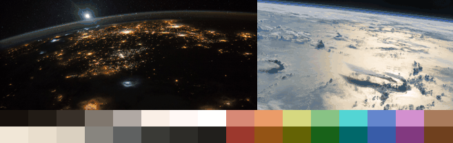

# Saved looks

How to keep a set of wallpapers you liked, one per monitor, together with the theme you saw them
with, and bring the whole thing back later by name. The design and its reasons are in
[design.md, "Saved looks"](design.md#saved-looks-designed-in-v012).

Parts marked *experimental* (history, `amo theme list`, `amo theme preview`, `--order` and the
rofi format) may change or go in a minor release: they are being tried in a real theme picker
and kept or removed after a week or two of use.

## What you need

- An indexed library (`amo index`).
- `group.setter` in the config: the command that sets one monitor's wallpaper, run once per
  monitor with `AMO_MONITOR` and `AMO_WALLPAPER` (as for `amo group --apply`). Without it a look
  applies its palette alone, with a warning.

## Save what is on screen

A look is saved from the last `amo group --apply` and the theme applied from its primary:

```sh
amo group commons-good-morning-iss --monitor DP-1=21:9 --monitor HDMI-1=16:9 --apply
amo theme apply commons-good-morning-iss    # the theme from the group's primary
amo theme save iss-morning --description "the ISS at dawn, cloud tops beside it"
```

`amo theme save NAME` writes the profile's palette, the run's variant and tone, and the group's
pictures (by record id and file, and each monitor's ratio) to `.amo/palettes/NAME.yaml` in a
library root, and prints the path. It saves pictures only when the group's primary is the
picture the theme came from (the same record: a 21:9 crop of it counts); otherwise it saves a
preset without them, says why, and puts it in `$XDG_CONFIG_HOME/amontillado/palettes/`.
`--palette-only` always saves a preset.

Where a look goes:

- **In the root of its most private picture**: the NSFW root if any of its pictures is not sfw,
  else the primary's root. An SFW root never names an NSFW record.
- **A preset** goes to the config's `palettes/`, which is often a public dotfiles repository: a
  preset made from a picture that is not sfw is saved without its `source` (the picture's
  name and record).

An existing name is refused without `--force`, which keeps the file's `id` (so its statistics
follow) and any top-level keys you added by hand (`notes:`, say), but not its comments: it
warns when there were some. Inside `look` and the variants, an unknown key makes the file
invalid instead, so a typo there is caught rather than ignored. A name already saved in another library root is refused outright. With version control
(`on_change`), the new file is reported as a change in its root.

## Apply it again

```sh
amo theme apply --palette iss-morning                 # palette, variant, tone and pictures
amo theme apply --palette iss-morning --monitor DP-1=21:9   # on these monitors
amo theme apply --palette iss-morning --palette-only  # the colours alone
```

NAME is looked up in the library roots' `.amo/palettes/` first, then the config's presets; a
look shadowing a preset of the same name is warned about, and every apply logs the file used.
Picture *i* goes on monitor *i* (from `--monitor`, else the last `amo group --apply`), its saved
file when it fits the monitor's ratio, else the record's file for that ratio. Fewer monitors
than pictures: the rest are left out. More: the extra monitors get companions of the primary, of
the purities the look's own pictures have, offered first when there is a terminal. The setter
runs after the apps' reloads, so a wallpaper hook that sets every monitor does not undo the look.

## History *(experimental)*

Every activated `amo theme apply` adds a numbered row to a history in the index: the palette, the
run's variant and tone, and the pictures on screen. `theme.history_size` (default 200; 0 keeps
none) bounds it. A row keeps its number for good:

```sh
amo theme list --history                 # NUMBER, time, palette, primary file; newest first
amo theme apply --history 12             # row 12 again, as a look
```

A row naming a picture that is not sfw is listed only with `--purity`, so a picker opened
during a screen share does not offer one.

## Choosing one *(experimental)*

`amo theme list` prints the saved looks and presets (`NAME<TAB>KIND<TAB>PATH`, KIND `look`,
`preset`, or `shadowed` for a preset a look hides). The NSFW root's looks are listed only with
`--purity`. `--order recent`, `most-applied` and `least-applied` use how often each was
applied; `--format json` carries the counts.

`amo theme preview` draws a theme's card: each monitor's picture at its aspect, the primary
first, over a strip of `base00`-`base0F` for each variant the theme would apply, in its tone.
A preset is the strip alone.



*The card of a look of two NASA photographs, public domain: "Good Morning From the
International Space Station" (Scott Kelly) and "Cloudscape Over the Philippine Sea", both from
Wikimedia Commons.*

```sh
amo theme preview --palette iss-morning     # in the terminal (kitty graphics), else crop.viewer
amo theme preview forest                    # the palette a picture would give, beside it
amo theme preview --history 12 -o card.png  # a history row, to a file
```

Cards are cached in `$XDG_CACHE_HOME/amontillado/previews/`; one showing a picture that is not
sfw only in `$XDG_RUNTIME_DIR` (memory, gone at logout).

A picker with rofi, the cards as icons:

```sh
path=$(amo theme list --format rofi | rofi -dmenu -show-icons -p look) &&
  amo theme apply --palette "$path"
number=$(amo theme list --history --format rofi | rofi -dmenu -show-icons -p history) &&
  amo theme apply --history "$number"
```
